# Data augmentation with GANs for breast cancer detection in thermal images

> **Master's Thesis** · MSc in Data Engineering and Data Science (UNED) · June 2025
> Supervised by Mariano Rincón Zamorano and José Manuel Cuadra Troncoso
> 📄 [Full thesis (PDF, in Spanish)](docs/Roman_Aguilar_Rafael_TFM.pdf)

Can a **StyleGAN** trained on just 260 thermal images generate samples good enough to improve a breast cancer classifier? This project measures it with an experimental design built to avoid bias: **400 trained StyleGAN models, 5 augmentation settings (one of them the GAN-free baseline), 5-fold cross-validation repeated 10 times, and about 16 days of GPU compute**.

<p align="center">
  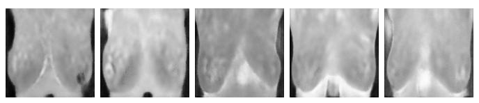
  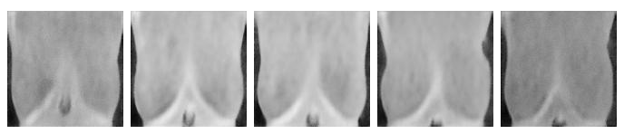
  <br><em>Synthetic images generated by two StyleGANs, one per class. Left: healthy. Right: sick.</em>
</p>

## Summary

| | |
|---|---|
| **Problem** | Early breast cancer detection with thermography. The dataset is small: 260 images (166 healthy, 94 sick), which limits generalization. |
| **Idea** | Generate synthetic images with StyleGAN, filter them by quality and add them to the training set of a **hard attention** classifier, the best model from my previous work. |
| **Variable studied** | Amount of synthetic images added: 0, 768 (~25 %), 1536 (~50 %), 2304 (~75 %) and 3072 (~100 %). |
| **Main result** | Adding ~50 % synthetic images gave the best trade-off: higher recall (0.845 vs. 0.838), AUC 0.87 vs. 0.86 and fewer false negatives (186 vs. 194), at a lower compute cost than 75 % and 100 %. |
| **Honest conclusion** | The improvements are **small** (one to two thousandths or hundredths depending on the metric) and come with a run that is ~80-90 times slower (from 66 min to ~4 days). **There is not enough data or testing to rigorously claim that this method improves detection**: the results are hints, not proof. |

## What was done

### 1. Choosing the generative model
A **sGAN** (semi-supervised GAN) and a **StyleGAN** were tested. The sGAN gave no useful results even after 10,000 epochs (24 h). StyleGAN, implemented from scratch in PyTorch, did.

Key improvement: instead of training at 56×56 (the classifier's resolution), the dataset is **rescaled to 128×128** to get 6 progressive training steps instead of 4. This took the output from blurry to sharp images in just 2.5 h.

<p align="center">
  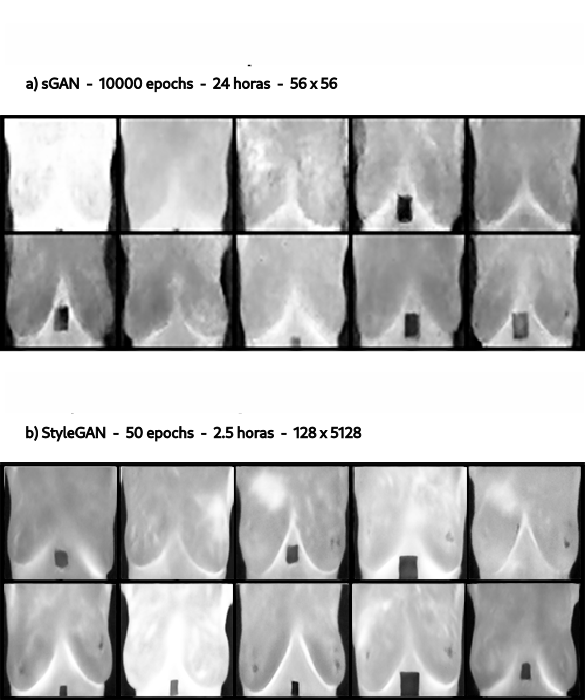
  <br><em>Top: sGAN after 24 h. Bottom: StyleGAN after 2.5 h, using 128×128 during training.</em>
</p>

### 2. Two GANs, one per class, with hyperparameter tuning
Each class has its own StyleGAN, so each generator learns a single distribution. A **grid search** was run over the generator and discriminator learning rates and Adam's β₁ and β₂. The criterion was the **KID Score** computed on 10,000 images. Both searches took about 78 h in total.

This was the best configuration:

| Model | Time | KID | FID | Gen. LR | Dis. LR | β₁ | β₂ |
|---|---|---|---|---|---|---|---|
| Healthy | 45.2 h | 0.107 | 178.8 | 1e-4 | 1e-3 | 1e-5 | 0.9 |
| Sick | 33.1 h | 0.128 | 212.9 | 2e-4 | 1e-3 | 0.5 | 0.9 |

Tuning reduced **convergence failures** (completely black images) and improved sample quality.

<p align="center">
  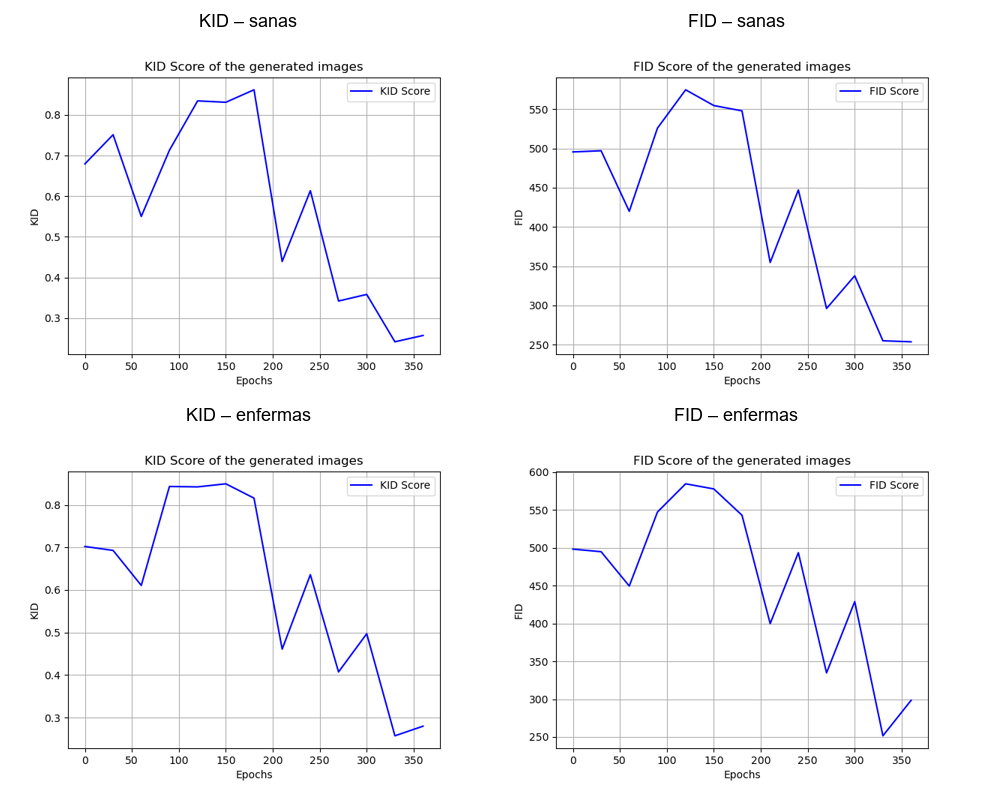
  <br><em>Note: both of these metrics represent better synthetic images when their values are close to zero.</em>
</p>

### 3. Quality filtering of synthetic images (KID)
GANs trained on little data sometimes produce samples that look little like the real ones. For that reason, batches of 64 images only enter the dataset if their **KID Score** against the validation set is ≤ 0.25. If a batch fails, it is regenerated. After 3 failed attempts the last one is accepted to avoid infinite loops. KID is the main metric because FID is biased with few samples.

### 4. Cross-validation without data leakage
The evaluation design is the most carefully built part of the project. The classical augmentation (flip and brightness) is the one shown in the figure below:

<p align="center">
  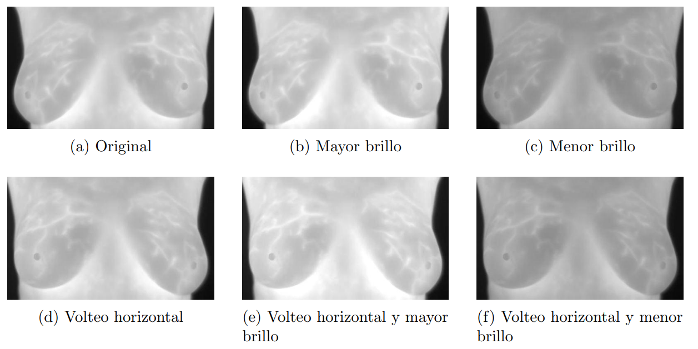
</p>

- Each real image has 10 classically augmented versions (horizontal flip and brightness), giving **3113 samples**. With `StratifiedGroupKFold` grouped by patient, no augmented image ends up in a different split than its original.
- The test set contains **only real images**.
- The GANs are trained **only on each fold's training set**, and the validation subset serves as an external reference for KID/FID. That subset is then added back to the classifier's training data so no data is wasted.
- The whole process is repeated **10 times** to measure mean, variance and standard deviation, instead of settling for a single favorable result.

<p align="center">
  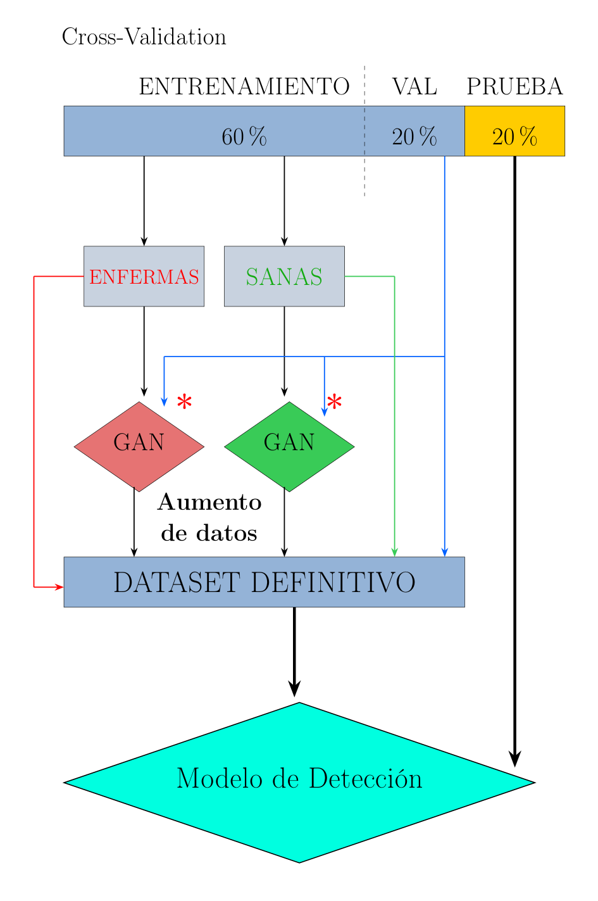
</p>

### 5. An experiment that did not work
I tried the *non-leaking augmentations* technique from Karras et al. (2020), which applies transformations to the discriminator with p = 0.8 to stabilize training on little data. It **worsened KID** (from ~0.2 to ~0.3) and produced blurrier images. With only 260 samples the dataset is too small for the technique to work, so I discarded it.

<p align="center">
  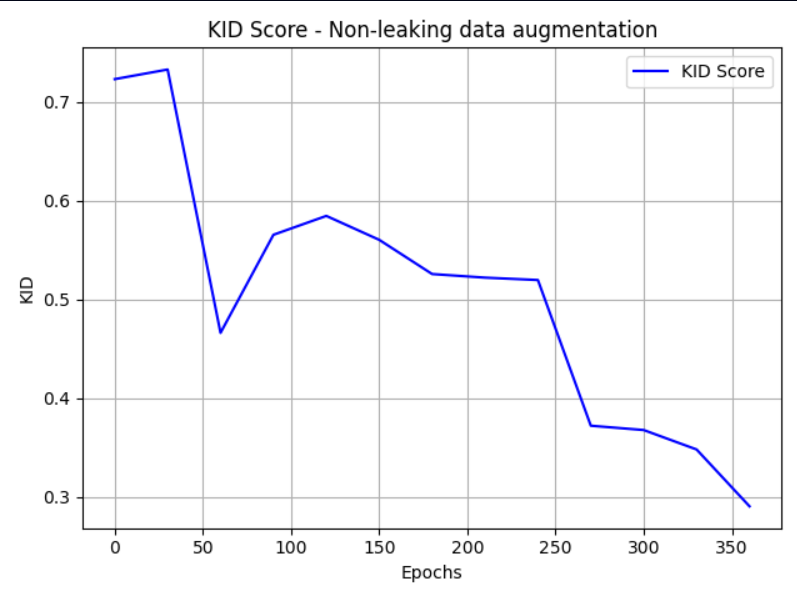
  <br><em>KID Score with the non-leaking technique: values around 0.3 at the end of training.</em>
</p>

## Results

Hard attention classifier, 10 repetitions × 5 folds. The mean of each metric is shown.

| Synthetic images | Accuracy | Specificity | Precision | Recall | F1 | AUC | Time |
|---|---|---|---|---|---|---|---|
| 0 (baseline) | 0.865 | 0.885 | 0.848 | 0.838 | 0.839 | 0.86 | 66 min |
| ~25 % (768) | 0.867 | 0.888 | 0.852 | 0.841 | 0.841 | 0.86 | 91.5 h |
| **~50 % (1536)** | 0.870 | 0.887 | 0.859 | **0.845** | **0.845** | **0.87** | 93 h |
| ~75 % (2304) | 0.869 | 0.896 | 0.841 | 0.833 | 0.833 | 0.86 | 97.8 h |
| ~100 % (3072) | 0.870 | **0.897** | **0.862** | 0.835 | 0.844 | **0.87** | 98 h |

*Best values in each column are in bold, excluding the baseline. Full variances and standard deviations are in the thesis. A strict improvement criterion is used here: higher mean with equal or lower dispersion.*

<p align="center">
  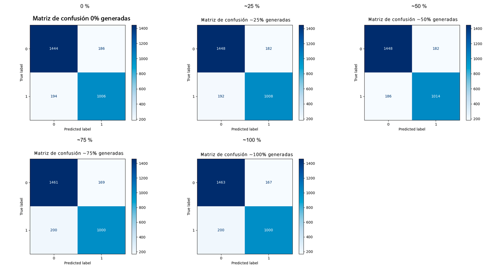
  <br>
  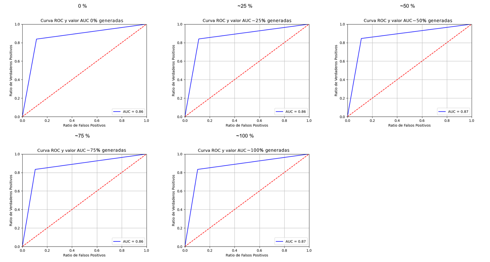
</p>

**Reading the results**

- All configurations with synthetic images match or beat the baseline in accuracy and specificity.
- **50 %** reduces false negatives (194 → 186) and raises recall. In a clinical setting this is the most important metric, because a false negative is an undetected cancer case.
- **75 %** worsens precision and consistency (F1 variance of 0.016 vs. 0.001 for the baseline).
- There is a direct relationship between generated images and time, because KID filtering forces batches to be regenerated.
- The differences are small compared with the variability between runs (for example, recall of 0.845 ± 0.09 vs. 0.838 ± 0.08: the standard deviations are much larger than the difference in means). No statistical significance test was performed, so **these results do not allow concluding that the method improves detection**, only that it does not clearly worsen it and that there is a slightly favorable trend.

### Computational cost
Each experiment with synthetic images trains 100 StyleGANs (5 folds × 2 classes × 10 repetitions), 400 in total for the 4 experiments with GANs. It ran on the UNED server (2 × NVIDIA Tesla V100, 96 GB of RAM).

<p align="center">
  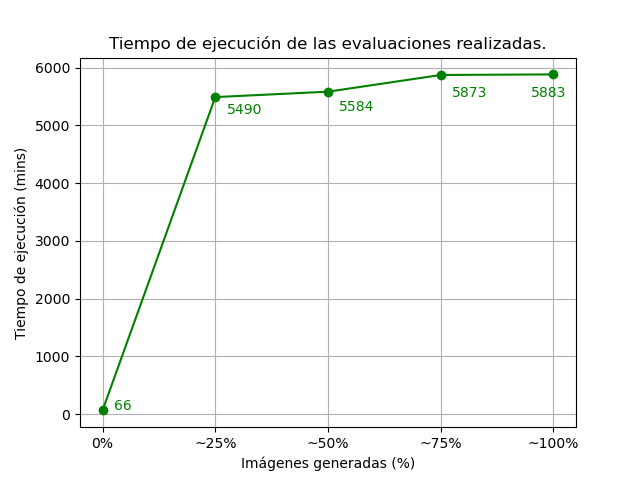
</p>

<p align="center">
  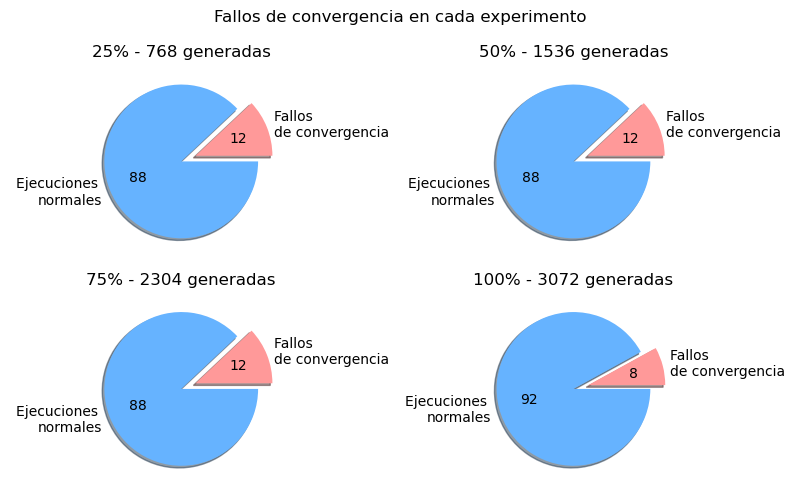
</p>

Convergence failures occurred in about **10 %** of the trainings (12 per experiment, 8 in the 100 % one). The synthetic images from those cases were kept instead of retraining, to avoid multiplying compute time.

### Interpretability with Grad-CAM
Grad-CAM was applied to sick patients with the models trained in each experiment, to see how the area the classifier focuses on changes. The models with 25 %, 50 % and 100 % synthetic images shift attention toward the lower part of the right breast, while the baseline model focuses on the left.

<p align="center">
  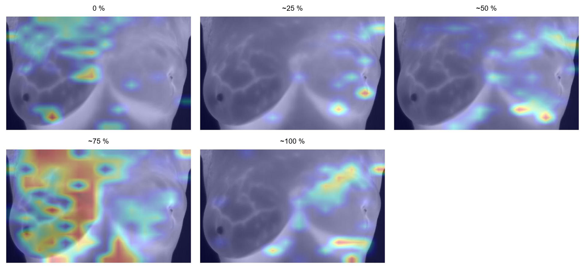
  <br><em>Grad-CAM on sick patient 192 by percentage of synthetic images.</em>
</p>

<p align="center">
  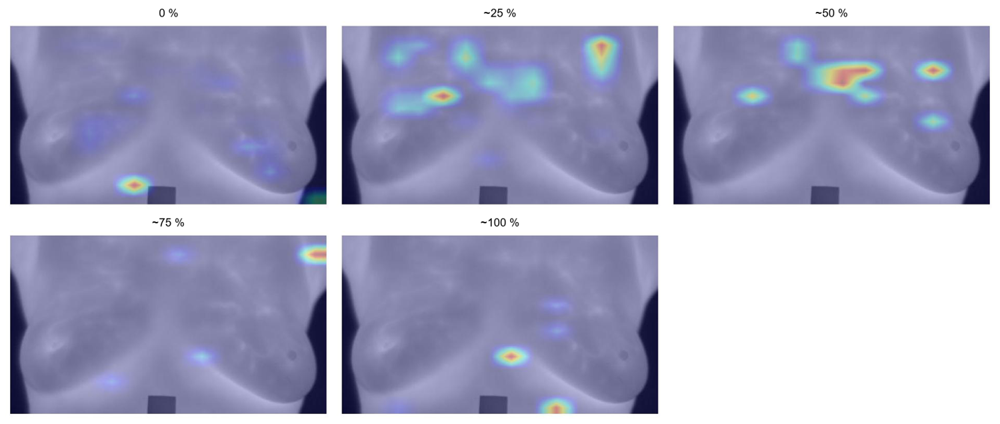
  <br><em>Grad-CAM on sick patient 245.</em>
</p>

## Technologies and skills demonstrated

- **Deep learning**: PyTorch, StyleGAN (from-scratch implementation with progressive training, AdaIN and mapping network), CNNs with attention mechanisms (self, soft and hard), Grad-CAM.
- **Generative model evaluation**: KID and FID with `torchmetrics`.
- **Experimental methodology**: grouped and stratified cross-validation, data leakage prevention, repetitions to estimate variance, statistical analysis.
- **Optimization**: hyperparameter grid search, detection and mitigation of collapse and convergence failures.
- **Compute**: multi-day experiments on a GPU server, parameterized through a constants file.
- **Scientific Python**: scikit-learn, pandas, NumPy, Matplotlib, OpenCV.

## Repository structure

```
├── models/                    # StyleGAN, cGAN and the 4 classifiers (CNN, self/soft/hard attention)
├── datasets/                  # CancerDetectionDataset class and label CSVs
├── constants.py               # Hyperparameters and experiment configuration
├── utils.py                   # KID/FID, quality filtering, generation and data splitting
├── train_StyleGAN.py          # StyleGAN training
├── hyperparameter_tuning.py   # Hyperparameter grid search
├── cross_validation.py        # Cross-validation with data augmentation (10 repetitions)
├── cross_validation_0_gen.py  # Baseline without synthetic images
├── augment_images.py          # Classical augmentation (flip and brightness) of the dataset
├── apply_grad_cam.py          # Grad-CAM maps on the trained models
├── sGAN.py, train_sGAN.py     # First attempt with a semi-supervised GAN
├── results/                   # Text results of the validations and tuning, and Grad-CAM
└── docs/assets/               # README figures
```

## Limitations and future work

- **Insufficient data**: the original dataset has only 260 images (94 sick) from a single source, and GANs normally need far more data. Without validation on an external set, the results cannot be generalized.
- **Insufficient testing**: there are only 10 repetitions per experiment, a single classifier architecture and a single GAN. No statistical significance tests were done, and the observed improvements (thousandths or a few hundredths) fall within the variability between runs.
- **Conclusion**: this work does not prove that GAN augmentation improves breast cancer detection. It shows a rigorous experimental design and a trend that deserves confirmation with more data and more experiments.
- **No clinical use**: the model is an academic experiment and must not be used for diagnosis.
- Possible directions: **StyleGAN2/3**, **transfer learning** from a pretrained generator, a larger dataset and more tuning and training iterations.

## Author

**Rafael Román Aguilar** · [GitHub](https://github.com/rafaroman18)

The StyleGAN implementation builds on the reference code by [Elilah (2023)](https://www.kaggle.com/code/tauilabdelilah/stylegan-implementation-from-scratch-pytorch).
